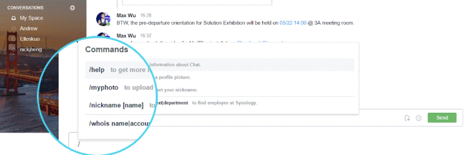

# Synology Chat and Jitsi Meet Webhook


Webhook to create Jitsi Meet meetings via a Slash command `/meeting`
in Synology Chat.

## Feature

- A [Slash command](https://kb.synology.com/en-eu/DSM/tutorial/How_to_configure_webhooks_and_slash_commands_in_Chat_Integration) in Synology Chat to create a `Jitsi Meet` room.

## Screenshots



## Tested

- Python 3.11 and Flask 3.1.2.

## Development environment

**Step 1:** Requirements

Install the Python requeriments, executing the following command:

```bash
sudo apt install -y python3-dev python3-pip
```

Add a user for `Jitsi Meet` deployment, executing the following command:

```bash
sudo useradd -m -s /bin/bash -c "Jitsi Meet User" -g sudo jitsi
```

Set the password for the user, executing the following command:

```bash
sudo passwd jitsi
```

Check if user was created, executing the following command:

```bash
id jitsi
```

Verify home directory exists, executing the following command:

```bash
ls -lahp /home/jitsi
```

Check user entry in passwd file, executing the following command:

```bash
grep jitsi /etc/passwd
```

Switch to the user (to test), executing the following command:

```bash
su - jitsi
```

---

**Step 2:** Clone the Repository

Clone the repository, executing the following command:

```bash
cd ~/ && git clone https://github.com/macagua/synology-chat-jitsi-webhook.git
```

Access the installation directory, executing the following command:

```bash
cd ~/synology-chat-jitsi-webhook/
```

---

**Step 3:** Set Up the Virtual Environment:

Create the Virtual Environment:

```bash
python3 -m venv venv
```

Activate the Virtual Environment:

```bash
source ./venv/bin/activate
```

---

**Step 4:** Install Python Dependencies:

```bash
pip3 install -r ./requirements.txt
```

---

**Step 5:** Configure slash command:

You need to configure a slash command, and copy the `token` generated, for more information checkout [here](https://kb.synology.com/en-us/DSM/tutorial/How_to_configure_webhooks_and_slash_commands_in_Chat_Integration#x_anchor_id7).

---

**Step 6:** Setup enviroment variables:

Copy the `.env.example` file to `.env`, executing the following command:

```bash
cp .env.example .env
```

Fill in the values, executing the following command:

```bash
nano .env
```

Replace the following values:

- `SYNO_SLASH_TOKEN`: Replace with your `Synology Chat` Token, previously copied in **Step 5: Configure slash command**.

- `JITSI_DOMAIN`: Replace with your `Jitsi` domain, the value by default is: `lsnchat.lifesitenews.com`.

- `JITSI_APP_ID`: Replace with your `Jitsi` Application ID defined in the section: [Step 6.2.1: Generate a JWT Secret](https://github.com/macagua/jitsi-synology-nas-single-sign-on/blob/main/README.md).

- `JITSI_APP_SECRET`: Replace with your `Jitsi` Application secret defined in the section: [Step 6.2.1: Generate a JWT Secret](https://github.com/macagua/jitsi-synology-nas-single-sign-on/blob/main/README.md).

Load environment variables from the `.env` file:

```bash
set -a; [ -f .env ] && source .env; set +a;
```

Run the webhook `app`, executing the following command:

```bash
gunicorn -b 127.0.0.1:5001 app:app
```

This way, you already have the webhook app running, listening at: http://0.0.0.0:5001.

You can test it by sending a `POST` request to the `/slash/meeting` endpoint.

### Deploy with Docker

Optionally, you can deploy the webhook `app` using a Docker container.

To build the Docker image, executing the following command:

```bash
make dev-build
```

To run the Docker container, executing the following command:

```bash
make app-run
```

For more `make` tasks avalaibles checkout the help, executing the following command:

```bash
make help
```

## Production environment

For deployment in production environment you need, update your system, to freshen up your packages installed, next that is necessary are the Nginx service dependencies, next that you need to install `nginx` as webserver, and `Certbot` to automate SSL certificate generation, executing all in one, with the following command:

```bash
make pre-requirements
```

### `systemd` service settings

Configure an systemd service file for this webhook app in **Step 8: Setup a Gunicorn Service**.

---

**Step 7:** Update `nginx` Configuration

Add the following lines as the first location blocks:

```bash
sudo nano /etc/nginx/sites-available/lsnchat.lifesitenews.com.conf
```

Example content:

```nginx
    # Jitsi integration with Synology Chat
    location /slash/meeting {
        proxy_pass http://127.0.0.1:5001/slash/meeting;
        proxy_set_header Host $host;
        proxy_set_header X-Real-IP $remote_addr;
        proxy_set_header X-Forwarded-For $proxy_add_x_forwarded_for;
    }
```

Test `nginx` server settings, executing the following command:

```bash
sudo nginx -t
```

Restart the `nginx` service to apply the changes, executing the following command:

```bash
sudo systemctl status nginx && sudo systemctl reload nginx && sudo systemctl status nginx
```

You can audit the `nginx` error log file, executing the following command:

```bash
sudo tail -f -n 350 /var/log/nginx/error.log
```

Also, you can audit the service executing the following command:

```bash
sudo journalctl -u nginx -f --since "5 minutes ago"
```

Alternatively, you can audit the general events into the `nginx` access log file, executing the following command:

```bash
sudo tail -f -n 350 /var/log/nginx/access.log
```

---

**Step 8:** Setup a `Gunicorn` Service

Copy the `systemd` service file, executing the following command:

```bash
sudo cp ~/synology-chat-jitsi-webhook/etc/systemd/system/synology-chat-jitsi-webhook.service /etc/systemd/system/
```

Edit the `systemd` service file, executing the following command:

```bash
sudo nano ./etc/systemd/system/synology-chat-jitsi-webhook.service
```

Replace the following value:

- `YOUR_TOKEN_GENERATED_BY_SYNOLOGY`: Replace with your Synology token generated, previously copied in **Step 5: Configure slash command**.

Reload `systemd`, executing the following command:

```bash
sudo systemctl daemon-reload
```

Start the service, executing the following command:

```bash
sudo systemctl start synology-chat-jitsi-webhook
```

Enable the service, executing the following command:

```bash
sudo systemctl enable synology-chat-jitsi-webhook
```

Check the status:

```bash
sudo systemctl status synology-chat-jitsi-webhook
```

Check the logs of your `Jitsi Auth` App event log file for any errors, executing the following command:

```bash
sudo tail -f -n 350 ~/synology-chat-jitsi-webhook/app.log
```

Alternatively, you can audit the service. executing the following command:

```bash
sudo journalctl -u synology-chat-jitsi-webhook -f --since "5 minutes ago"
```

### `Synology Chat` settings

In `Synology Chat`:

- Go to Integrations → Slash Command → Add

- Command: `/meeting`

- URL: https://synoji.lifesitenews.com/slash/meeting

- Token: the same as your `.env` file

---

**Step 9:** Verification

In `Synology Chat` to verify everything is working correctly:

- Test on a channel, executing the following slash command:

  ```bash
  /meeting
  ```

  That generated a `Jitsi Meet` room with the username-based name.


- Or create a named room, executing the following slash command:

  ```bash
  /meeting name=sales_meeting
  ```

  That generated a `Jitsi Meet` room with the provided name in this case `sales_meeting`.

---

**Step 10:** `API` endpoints

For the Synology Chat integration are the following endpoints:

- `/`, Home page.

- `/slash/meeting`, Handle the /meeting slash command from Synology Chat.

Congratulations! You have successfully instegrated the `Synology Chat` with `Jitsi Meet` using a webhook on your `LSN` platform.
